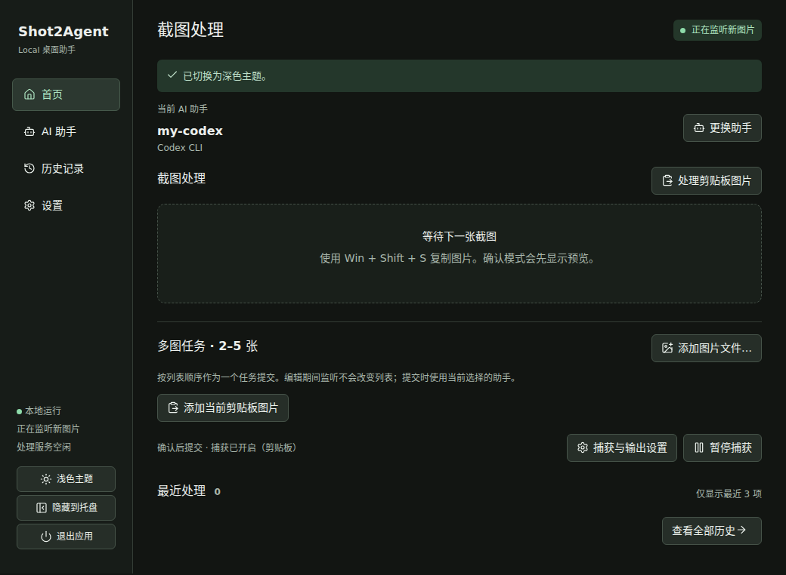

# Shot2Agent

把截图交给 AI 处理，结果留在电脑上。

Shot2Agent 是一个 Windows 桌面小工具。你用系统截图工具截取图片，它把图片交给你选好的 Codex、Claude Code 或 GLM，完成后可以复制文字、粘贴成 Markdown 文件，或自动保存到文件夹。处理记录可以在应用里随时查看。

应用和任务历史都在本机，不需要搭建服务器。使用在线模型时，截图仍会发送给你选择的模型服务，并按该服务的规则计费。

## 下载和准备

到 [Releases](https://github.com/blooddrunk/Shot2Agent/releases) 下载正式版的 **Shot2Agent-Windows-x64.zip**。不要下载页面里的 Source code；那是源码，不是可以直接打开的应用。带 `rc` 或 `Pre-release` 标记的是候选版本。

你需要一台 Windows 11 64 位电脑，以及一个已配置好的 AI 助手：

| 你准备使用 | 开始前需要准备 |
| --- | --- |
| Codex | 在这台 Windows 电脑安装并登录 Codex CLI |
| Claude Code | 安装并登录受支持的 Claude Code 版本 |
| GLM | 安装受支持的 Claude Code，并准备 GLM Token；不需要 Claude 个人账号登录 |

这里的 CLI 是助手提供商的本机程序，不是 Shot2Agent 的命令行。它的安装和登录按提供商的说明完成；Shot2Agent 里的配置都在窗口内操作。Claude Code 当前支持的版本、安装说明和 GLM 配置见[完整使用手册](docs/USER_GUIDE.md#配置-ai-助手)。

Shot2Agent 自带运行环境，不需要另外为它安装 Node、pnpm 或 Git。Windows 需要 [Microsoft WebView2 Runtime](https://developer.microsoft.com/microsoft-edge/webview2/)。如果应用打开时提示缺少 WebView2，再从微软页面安装。

## 第一次使用

1. **完整解压 ZIP**，例如放到 `D:\Apps\Shot2Agent`。不要在压缩包里面直接双击程序。
2. 双击 **Shot2Agent.exe**。第一次打开时，点击“添加 AI 助手”。
3. 选择助手类型和已发现的本机安装，给它取一个名称，例如 `my-codex`。如果选择 GLM，再填入端点、模型和 Token，点击“保存 Agent”。保存 Token 本身不会发送模型请求。
4. 打开“设置”，勾选“监听剪贴板中的新图片”，提交方式选“确认后提交”，剪贴板返回先选“手动复制”，然后点击“应用设置”。
5. 按 **Win + Shift + S** 截取一张图片。回到首页，确认预览后点击“提交图片”。
6. 等待任务完成。在历史里点“复制文本”，粘贴到编辑器；或者点“复制文件”，到资源管理器按 **Ctrl + V**，得到一个可以打开的 `.md` 文件。

如果只想处理一次剪贴板里的图片，也可以直接点首页的“处理剪贴板图片”，不必开启持续监听。



关闭窗口会隐藏到系统托盘，应用仍在后台。要完全退出，请在托盘菜单选择 **退出 Shot2Agent**。

## 接下来可以做什么

- 从一个截图文件夹接收新图片，或同时监听文件夹和剪贴板。
- 把 2–5 张相关图片排好顺序，作为一个任务提交。
- 自动复制文字或 Markdown 文件，同时保存结果、显示 Windows 通知。
- 在历史里查找结果、删除旧记录，在设置里清理文件复制缓存。

[快速开始](docs/LOCAL_V1_GUIDE.md)按点击步骤介绍第一张截图。[完整使用手册](docs/USER_GUIDE.md)包含所有配置、常见问题、ZIP 文件说明和升级备份方法。

## ZIP 里哪些文件要保留？

运行需要 **Shot2Agent.exe 和整个 runtime 文件夹**，两者必须放在同一个目录下。不要删除或单独移动 `runtime` 里的文件。

其他启动脚本、说明文档和构建校验文件不是日常运行的必需项。其中 `Start acceptance.cmd` 只用于离线测试；正常使用打开 EXE 即可。保留 `BUILD.txt` 和 `MANIFEST.json` 有助于核对版本。详细用途见[安装包文件说明](docs/USER_GUIDE.md#安装包文件说明)。

## 升级前

从托盘退出应用，在“设置”显示的数据位置备份整个数据目录，然后把新版完整解压到另一个目录。新程序会继续使用原来的本地数据。Token 由 Windows 凭据管理器保管，不在目录备份里；换电脑时需要重新填写。[升级、备份与回退](docs/USER_GUIDE.md#升级备份与回退)

## M11-X 开发候选：原生截图与直接输入

当前分支增加整屏原生截图（可只保存 PNG、保持剪贴板不变），以及从最新/历史结果手动输入其他应用。均在 GUI 配置，快捷键默认关闭。独立 Local 与可选 Remote 保持原有流程；此功能不在旧 Local v1.0.2 ZIP 内。见[使用说明](docs/USER_GUIDE.md#原生截图与直接输入m11-x-开发候选)、[范围](docs/M11_X_SCOPE.md)和[验证与最小原生步骤](docs/M11_X_VALIDATION.md)。

## 当前范围

M12-V 开发候选新增可选的 **Linux VPS Worker**，优先支持 Claude Code + GLM，也支持通过本机 sandbox 检查的 Codex 和个人 Claude 认证。它与 Relay 分开部署，Windows 端只需在现有 Remote 选择器选择 `Linux VPS` 的已批准助手。见 [VPS Worker 部署](deploy/relay/WORKER.md)和[验证记录](docs/M12_V_VALIDATION.md)；旧 Local Release 不受影响，未发布正式 v1.1.0。

当前开发分支增加可选的 **Remote 跨设备处理**：在设置中连接私人 HTTPS Relay、保存设备 Token、选择另一台电脑的已批准 Agent，由原电脑接收结果。默认仍为独立 Local；旧 Local v1.0.2 Release 不包含此开发功能。使用和限定验收见 [Remote 指南](docs/REMOTE_GUIDE.md)，[实际验证状态](docs/M10_R_VALIDATION.md)与 [VPS Compose 部署](deploy/relay/README.md)。尚未正式发布 v1.1.0。

已发布的 Local v1.0.x 提供同一台 Windows 电脑上的截图处理。模型是否支持图片、账号额度和网络连通性由所选提供商决定。文件复制提供 Markdown 结果；Windows 可能根据系统设置隐藏通知。执行结果不确定的任务不会自动重跑，避免重复请求或重复操作。

## 开发与验证

普通用户不需要构建源码。开发者使用 Node 22.16+、pnpm 10.19.0：

```sh
corepack pnpm install --frozen-lockfile
npm run check
npm run desktop:test-ui
```

[架构](docs/ARCHITECTURE.md) · [测试策略](docs/TESTING.md) · [发布验证记录](docs/M9_VALIDATION.md) · [历史开发规划](docs/ROADMAP.md)

界面图标使用 [Lucide](https://lucide.dev/guide/vue/)，随应用打包，不从网络加载。图标许可见 [THIRD_PARTY_NOTICES.md](THIRD_PARTY_NOTICES.md)。本仓库尚未选择项目许可证；公开源码不等于授予再分发许可。
